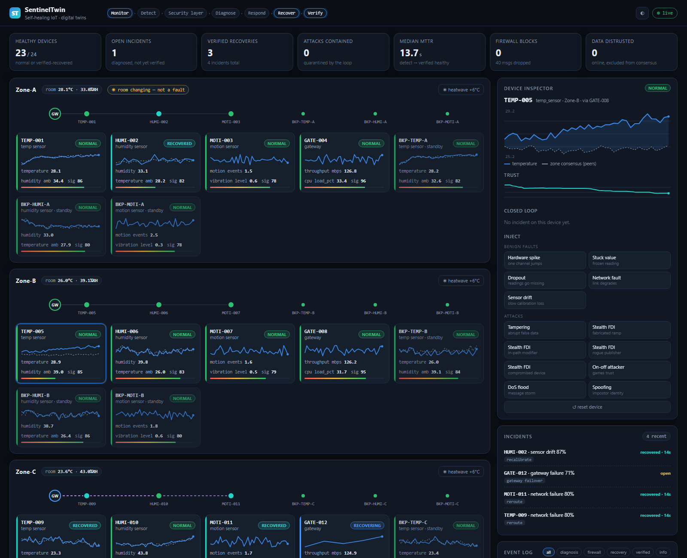
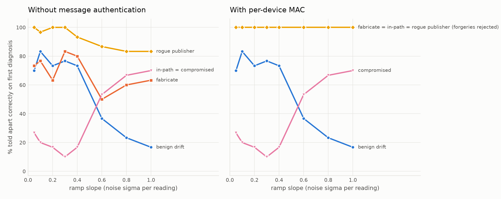

# SentinelTwin
### An explainable digital-twin framework that tells a broken IoT sensor from a lying one, heals it, and proves the fix held

SentinelTwin keeps a live **digital twin** of every IoT device and runs a closed loop over it:

```
Monitor → Detect → Security Layer → Diagnose (evidence) → Respond (expected cost) → Recover → Verify
```

Most IoT anomaly detectors stop at "something is wrong". SentinelTwin answers three harder questions,
which the literature review in [`reports/`](reports/) found are still open:

1. **Is it a fault or an attack?** One explainable diagnoser separates hardware faults, network and
   gateway failures, sensor drift and real environment changes from tampering, *drift-shaped* false-data
   injection, DoS floods and identity spoofing, on the same telemetry.
2. **What should we do when we are not sure?** Actions are chosen by *expected cost* over the cause
   probabilities, so under genuine drift-vs-attack ambiguity the system distrusts the data and keeps
   gathering evidence instead of guessing.
3. **Did the fix actually work?** Every action is verified afterwards against the device's last
   *verified* calibration. A failed verification means the diagnosis was wrong, and the loop escalates.



It runs on a simulated fleet, on **replayed real indoor physics** (Intel Berkeley Lab traces) and on
**real ESP32 + DHT22 hardware** over MQTT, all through the identical code path.

---

## Headline results

All numbers are measured, seeded and reproducible (`python -m experiments.run_all && python -m experiments.report`).
Full tables with 95% confidence intervals are in [`results/RESULTS.md`](results/RESULTS.md); figures are in
[`results/figs/`](results/figs/).

5,390 seeded episodes in total. Parameters were chosen only on development seeds 1000–1019 (`experiments/tune.py`),
never on the 30 evaluation seeds reported here.

| Question | Result |
|---|---|
| Does it diagnose the right cause? (11 fault/attack types, simulated physics) | **96.1%** first-diagnosis accuracy (macro-F1 0.968), **98.2%** after closed-loop escalation, **100%** verified recovery |
| …on **real** indoor physics (Intel Berkeley Lab traces replayed)? | **95.2%** first diagnosis (macro-F1 0.957), 98.5% final, 99.4% verified recovery |
| Explainable rules vs. learned models on the same evidence | **95.8%** vs. decision tree 89.7% and random forest 87.9%, with no training data needed |
| False alarms in fault-free operation | **0.017** incidents per device-hour (simulated), **0.028** (real traces); **5.25** without zone consensus |
| A real zone-wide heatwave (+6 °C) | **0.03** false incidents with zone consensus vs. **17.2** without it; a sensor drifting *during* the heatwave is still found in 96.7% of runs (6.7% without consensus) |
| A failed gateway | 100% diagnosed as the root cause; **0** of its child devices isolated |
| Benign faults wrongly quarantined | **2.2%** with expected-cost response vs. **20.0%** when acting on the most likely cause alone |
| What if recovery is not verified? | **50.9%** of "recoveries" are false, and 64.9 child isolations per gateway failure (alarm storm) vs. 0 |
| Slow drift-shaped false-data injection | rogue publishers recognised in 83–100% of cases at every slope; with a per-device MAC, fabricated, in-path and rogue forgeries are 100% rejected before reaching the data |
| The honest limit: a *compromised* device ramping its true readings | indistinguishable from drift on first diagnosis at slow slopes (10–27% recognised below 0.4 σ/reading), yet **92.1%** end up contained because recalibration fails verification and the loop escalates |
| Trust under an on-off attacker | asymmetric trust holds a repeat offender at **0.06** vs. 0.21 (symmetric EMA) and 0.28 (beta reputation) |



**Known weak spots, reported as measured:** on real traces 23% of benign drifts are first quarantined (all later
recovered); a slow ramp attack can be mistaken for a single-sensor hardware fault before escalation corrects it; all
timings are in simulated time, and the Intel traces are replayed about 20× faster than real time, which makes their
dynamics harsher than reality. The real-trace suite exposed one design flaw during development (jumps judged on raw
values rather than relative to peers); it was fixed and every suite was re-run.

---

## What is new here (and what is not)

The building blocks are not new: per-device twins, z-score detection, EMA trust, MAPE-K style self-healing
and rate-based DoS detection all exist in prior work (see the research report). The contributions are in
how they connect and in what is measured:

| Contribution | Where |
|---|---|
| **Zone consensus**: co-located devices measure the same physics, so a leave-one-out, trust-weighted median tells "the sensor is wrong" from "the room changed" | `consensus.py` |
| **Evidence-based fault/attack arbitration** with an explicit threat model: every diagnosis is a probability per cause plus the human-readable evidence lines that produced it | `diagnosis.py` |
| **Drift vs. drift-shaped tampering**: physical aging-rate prior, co-movement with the room's physics, transport provenance (sequence numbers, publisher fingerprint, optional per-device HMAC) | `diagnosis.py`, `security.py`, `ingest.py` |
| **Expected-cost response under uncertainty**, including a `DISTRUST_DATA` containment action, plus a pre-action safety check on standby coverage | `response.py` |
| **Post-action verification** against the last verified offset (re-learning cannot launder an attacker's offset), with escalation and phase-level timestamps | `recovery.py`, `incidents.py` |
| **Measured cost of misdiagnosis**: false quarantines, false recoveries, wrong readings accepted, outage, collateral drops | `experiments/` |
| **Alarm-storm suppression**: a failed gateway is diagnosed as the root cause; its children are not isolated | `diagnosis.py` (`UPSTREAM_FAILURE`) |
| **Fingerprint-scoped quarantine**: block only an impostor publisher, keep the genuine device online | `security.py`, `ingest.py` |
| **SentinelTwin-Bench**: a labelled trace with benign faults, drift, environment events and attacks on the same telemetry | `tools/export_dataset.py` |

**Honest limits** (also measured, not hidden): a compromised device that adds a slow ramp to its true
readings with valid credentials is, on telemetry alone, indistinguishable from drift. SentinelTwin first
calls it drift, and catches it only when recalibration fails verification (see RQ3). A frozen per-device
baseline cannot separate drift from real environment change without peers; zones need at least three
co-located sensors of a quantity. Reconnaissance (scans) is not addressed.

---

## Architecture

| Module | Role |
|---|---|
| `simulator.py` | Physically-grounded testbed: per-zone environment (diurnal cycle, random walk, heatwaves, or real traces), 12 injectable fault/attack modes with ground truth and realistic action efficacy |
| `ingest.py` | Single ingestion boundary for simulated **and** real messages: firewall, flood, identity, provenance, MAC |
| `consensus.py` | Zone consensus and per-device residuals |
| `anomaly_detector.py` | Point, residual, baseline, stuck and dropout scores, with a running noise estimate |
| `security.py` | Escalating time-boxed firewall (device- or publisher-scoped), rate tracker (learned cadence ×5 or μ+3σ), provenance, fast-path tampering check |
| `diagnosis.py` | Evidence collection and arbitration into cause probabilities |
| `trust.py` | Symmetric EMA, asymmetric EMA (with a ceiling for repeat offenders), beta reputation |
| `response.py` | Expected-cost policy plus the baseline policies (argmax, naive restart, no healing) |
| `recovery.py` | Actions, containment, verification, escalation |
| `engine.py` | One tick of the whole loop; used by both the server and the experiments |
| `config.py` | Every switch the evaluation ablates |
| `clock.py` | Wall clock for the server, simulated clock for experiments (fast and exactly reproducible) |
| `main.py`, `static/index.html` | FastAPI + WebSocket live dashboard |
| `mqtt_bridge.py`, `arduino/`, `tools/` | Real hardware path, hardware campaign, test publisher, dataset export |

---

## Run it

```bash
python -m venv .venv && .venv/Scripts/activate      # Windows; use .venv/bin/activate elsewhere
pip install -r requirements.txt
uvicorn main:app --reload --port 8000                 # dashboard at http://localhost:8000
```

On the dashboard, pick any fault or attack from a device's menu (hardware spike, stuck value, dropout,
network, gateway failure, drift, abrupt tampering, four kinds of stealthy false-data injection, on-off
attacker, DoS flood, identity spoofing), or start a heatwave on a zone. You can then watch the cause
probabilities, the evidence, the chosen action and the verified outcome.

### Reproduce the paper's evaluation

```bash
python -m pytest -q                         # 20 end-to-end behaviour tests
python -m experiments.tune                  # parameter choice on development seeds 1000-1019 only
python -m experiments.run_all --seeds 30    # ~5,400 seeded episodes, all suites, ~35 min on 16 cores
python -m experiments.report                # results/RESULTS.md, summary.json, figs/
python tools/export_dataset.py --hours 6 --seed 7   # SentinelTwin-Bench labelled trace
```

The Tier B (real physics) suite needs the Intel Berkeley Lab data (~34 MB):
`http://db.csail.mit.edu/labdata/data.txt.gz` saved as `data/intel/data.txt.gz`.

### Real hardware (optional)

1. Run an MQTT broker (`mosquitto -p 1883`) and the server.
2. Flash `arduino/sentineltwin_esp32.ino` (set Wi-Fi, broker IP, device id; optionally a 64-hex
   `DEVICE_KEY_HEX` and a second DHT22 as a reference sensor).
3. With MACs enabled, point `SENTINELTWIN_DEVICE_KEYS` at a JSON file `{"REAL-TEMP-01": "<hex key>"}`.
4. Run the scripted hardware campaign and score it:
   `python tools/hw_campaign.py --devices REAL-TEMP-01 --rounds 5`. This writes ground truth, incidents
   and scores to `results/hw/`.

No ESP32? `python tools/test_publisher.py --fault drift|ramp|flood|spoof|network|hardware` sends real
MQTT traffic through the same path. Real devices are never compared with simulated ones as physical peers,
so give a real zone at least three co-located sensors.

### API

- `GET /api/devices`, `GET /api/events`, `GET /api/incidents`
- `POST /api/devices/{id}/inject` with body `{"fault_type": "...", "attacker": "...", "slope": 0.25}`
- `POST /api/devices/{id}/clear`
- `POST /api/zones/{zone}/heatwave` with body `{"magnitude_t": 6}`
- `WS /ws` streams snapshots, events and incidents

---

## Related work this builds on (verified citations)

- **Two-stage pipelines that separate anomaly flagging from causal diagnosis are an emerging design in
  digital-twin IoT security.** Dutta et al. (*Scientific Reports* 16:15732, 2026,
  doi:10.1038/s41598-026-47104-6) chain a contrastive-learning detector to a structural-causal
  root-cause stage and a blockchain audit log. In simulation on N-BaIoT they report a 68% shorter mean
  time to diagnosis and a 22% lower false-positive rate than benchmark IDS baselines. The paper does not
  isolate the contribution of the stage split, so we cite it as precedent for the architecture, not as
  evidence. SentinelTwin's own ablation (`no_security_layer`) tests that question directly.
- **Lightweight statistical rate monitoring is a defensible first line of defence for digital-twin
  traffic.** Rodrigues et al. (*Sensors* 25(24):7476, 2025, doi:10.3390/s25247476) flag packet or byte
  rates above a μ+3σ baseline and observed a ~50× packet-rate rise during DoS in a Docker testbed.
  `security.RateTracker` follows the same principle with a multiple of the learned cadence; both rules
  are compared in the evaluation (`rate_mu3sigma`).
- **Digital twins can detect compromised nodes that emit false data or attack neighbours.** Alanezi and
  Mishra (*IEEE Systems Journal* 18(2), 2024, doi:10.1109/JSYST.2024.3403500) host per-node twins on a
  fog server and detect misbehaving nodes with an MLP, treating erroneous data and attacks as one class.
  SentinelTwin separates benign faults from attacks, so only attacks trigger firewalling.
- El-Hajj (*Electronics* 13(19):3941, 2024, doi:10.3390/electronics13193941) paired an Eclipse Ditto
  twin (Docker, PC) with a Raspberry Pi device and a Snort IDS. Hping3 floods were detected, but NMAP
  scans raised only one or two alerts, and resource usage stayed elevated after attacks, which the author
  notes "suggests the need for better recovery mechanisms". SentinelTwin shares the reconnaissance blind
  spot and addresses the recovery gap.

The full literature review (58 checked references, gaps, datasets, venues) is in
[`reports/SentinelTwin research landscape.md`](reports/SentinelTwin%20research%20landscape.md).
